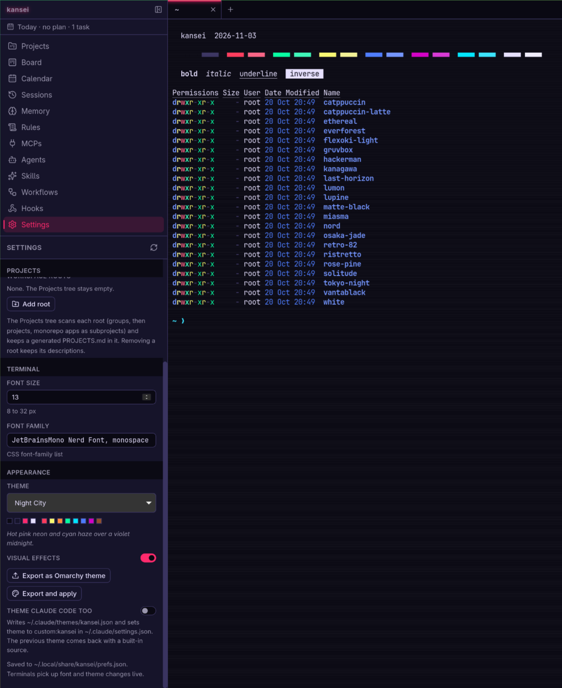
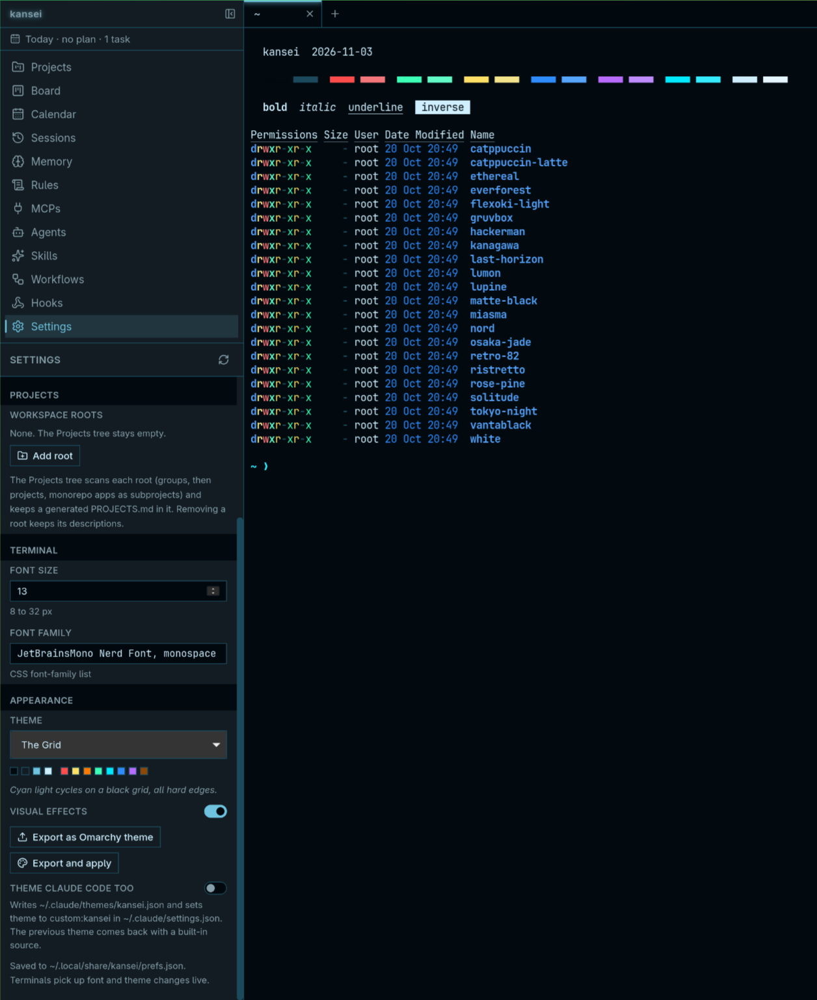

<h1 align="center">Kansei</h1>

<p align="center">
  <b>A Claude Code cockpit for Omarchy.</b><br>
  One window: a sidebar that edits everything Claude Code reads, a rail of terminal tabs that run <code>claude</code>, and the terminal filling the rest.
</p>

<p align="center">
  <a href="https://github.com/I4cTime/kansei/actions/workflows/ci.yml"></a>
  <a href="LICENSE"></a>
  
</p>

<p align="center">
  <a href="#what-it-is">What it is</a> &middot;
  <a href="#status">Status</a> &middot;
  <a href="#install">Install</a> &middot;
  <a href="#panels">Panels</a> &middot;
  <a href="#keyboard">Keyboard</a> &middot;
  <a href="#development">Development</a> &middot;
  <a href="#license">License</a>
</p>

---

## What it is

Kansei (管制, "control", as in a control tower) is a personal Claude Code
cockpit for [Omarchy](https://omarchy.org) (Arch + Hyprland). It was called
Tsukue ("desk") until 2026-11-03.

Claude Code keeps its state in plain files: `CLAUDE.md` memory, rules, MCP
servers in `~/.claude.json`, agents, skills, workflows, hooks and
`settings.json`, spread over `~/.claude` and every project's `.claude/`.
Kansei puts all of that in a left sidebar where you can read and edit the real
files, next to the terminals you run `claude` in. Each tab on the top rail is
a pty running `claude` (or a login shell) in a folder you pick, and all tabs
stay alive with their scrollback while you switch. Projects, sessions, a work
board and a calendar sit in the same sidebar, and the whole window can follow
the live Omarchy theme or wear one of seven sci-fi presets.

Built with Tauri 2 + React 19 + Tailwind v4 + xterm.js + CodeMirror 6, with
the pty in Rust (portable-pty). No Electron, no local HTTP server.

<p align="center">
  
  
</p>
<p align="center"><sub>Night City (left) and The Grid (right), two of the seven presets.</sub></p>

## Status

Kansei is a personal tool published as-is, not a product (yet). Read this
before you install it:

- **No releases, no binaries.** Build from source (see [Install](#install)).
  The version is 0.1.x and everything is on `main`.
- **Linux only.** The webview is WebKitGTK. It is built and used every day on
  Omarchy with an NVIDIA GPU, and `src-tauri/src/main.rs` carries
  NVIDIA/WebKitGTK workarounds for that setup (see [Run](#run)). Other
  distros and GPUs should work but get no testing.
- **Board and Calendar need a GitHub Project of yours.** Connect your own
  GitHub Project in Settings or the Board panel (owner, project number and a
  hub repo for epics); the project needs a few fields, listed under
  [Board](#board). Until then the Board shows a setup card and the Calendar
  plans days without tasks.
- **Everything else is generic Claude Code tooling**: Projects, Sessions,
  Memory, Rules, MCPs, Agents, Skills, Workflows, Hooks, Settings, Themes and
  the terminal tabs work on any machine with Claude Code, and they edit the
  real files under `~/.claude` and `~/.claude.json`. Kansei never touches
  `~/.claude/.credentials.json`.
- Some defaults follow the author's layout (workspace root `~/Develop`, a
  `~/.local/bin/claude` launcher when one exists); both are settings.

## Install

### Requirements

- [Claude Code](https://claude.com/claude-code) (`claude` on
  your `PATH`): what the terminal tabs run.
- Node 22+ and [pnpm](https://pnpm.io) (the repo pins `pnpm@12.3.4` through
  `packageManager`).
- Rust stable via [rustup](https://rustup.rs).
- `webkit2gtk-4.1` and the other
  [Tauri Linux prerequisites](https://v2.tauri.app/start/prerequisites/#linux).
- The [`gh` CLI](https://cli.github.com), logged in with the `project` scope,
  for the Board panel only.
- Omarchy is optional: when it is present, themes can follow it.

### Arch Linux (and Omarchy)

The PKGBUILD in `packaging/arch` builds the current `main` from GitHub and
installs `/usr/bin/kansei`, a desktop entry and icons:

```sh
git clone https://github.com/I4cTime/kansei.git
cd kansei/packaging/arch
makepkg -si
```

To build your local checkout instead (its committed state, not uncommitted
edits), point `KANSEI_SOURCE` at it:

```sh
cd packaging/arch
KANSEI_SOURCE=file://$PWD/../.. makepkg -f
sudo pacman -U kansei-*.pkg.tar.zst
```

More in [Packaging](#packaging).

### Other distros

Install the Tauri prerequisites for your distro, then:

```sh
pnpm install
pnpm tauri build --no-bundle   # binary at src-tauri/target/release/kansei
pnpm tauri build               # or deb, rpm and AppImage bundles
```

### From a checkout, in dev mode

```sh
pnpm install
pnpm tauri dev   # or ./run-dev.sh, see Run below
```

## Panels

The sidebar has twelve panels. The first ten have Ctrl+Shift+1..9 and 0
shortcuts (see [Keyboard](#keyboard)).

- **Projects**: every project under your workspace roots as a tree; open one
  as a Claude tab, open it with related projects, describe and link them. See
  [Projects and workspaces](#projects-and-workspaces).
- **Board**: a GitHub Project you connect (epics, tasks, lanes, dates), read
  and edited through `gh`. See [Board](#board).
- **Calendar**: a weekly rhythm, per-day notes and the board's scheduled
  tasks, written out to `SCHEDULE.md`. See [Calendar](#calendar).
- **Sessions**: Claude Code history, live sessions and transcripts; resume
  one into a tab.
- **Memory**: the `CLAUDE.md` files and the per-project memory folders under
  `~/.claude/projects`.
- **Rules**: user and project `.claude/rules` files, with their path globs.
- **MCPs**: MCP servers in `~/.claude.json` and `.mcp.json`, user and project
  scope, plus a read-only list of plugin, claude.ai and built-in servers.
- **Agents**: subagent definitions in `~/.claude/agents` and the project's
  `.claude/agents`.
- **Skills**: skills in `~/.claude/skills` and the project's `.claude/skills`.
- **Workflows**: the workflow scripts in `~/.claude/workflows`.
- **Hooks**: the hooks in the user `settings.json` or the project's
  `.claude/settings.json`.
- **Settings**: Claude Code's settings files (and a project's `CLAUDE.md`
  files), plus Kansei's own preferences (Appearance, This app).

Rules, Agents, Skills, MCPs, Hooks and Settings have a User / Project scope
switch; Project means the folder of the active tab.

## Run

```sh
pnpm install
./run-dev.sh          # detached dev build, log in /tmp/kansei-dev.log
pnpm tauri build      # release bundle (deb, rpm, AppImage)
```

On a machine with the NVIDIA driver the binary sets two driver variables for
itself before GTK starts (main.rs), overriding the session (a gaming profile
in ~/.config/environment.d exports `__GL_SYNC_TO_VBLANK=1`; set
`KANSEI_NVIDIA_ENV=keep` to opt out):
`__NV_DISABLE_EXPLICIT_SYNC=1`, because NVIDIA explicit sync makes WebKitGTK's
DMA-BUF renderer die with "Missing acquire timeline" (the software fallback
`WEBKIT_DISABLE_DMABUF_RENDERER=1` works too but types with visible lag), and
`__GL_SYNC_TO_VBLANK=0`, because otherwise a repaint while the window sits on a
hidden Hyprland workspace blocks the main thread in eglSwapBuffers until the
workspace is shown again ("Application Not Responding"). `run-dev.sh` sets
`KANSEI_DRIVER=/tmp/kansei-driver.sock`, a debug-only socket that runs
JavaScript inside the webview for UI checks (release builds ignore it):

```sh
./drive.py 'return t.store.get(t.tabs.tabsAtom).map(x => x.title)'
./drive.py --shot /tmp/kansei.png
```

`run-dev.sh` records the dev process group in `/tmp/kansei-dev.pid` and on the
next run stops only that group (plus whatever holds the Vite port 1420), never
processes by name, so an installed `kansei` keeps running. `./run-dev.sh stop`
only stops it. `drive.py --shot` prefers the dev window (`target/debug/kansei`)
when both are open.

Claude tabs run `~/.local/bin/claude` when that file is executable (a launcher
that can load MCP credentials before starting claude), otherwise `claude` from
PATH; set Settings, This app, "Claude command" to use something else.

The MCPs panel also lists, read only, the servers Claude Code loads from
installed plugins (`~/.claude/plugins`), the claude.ai connectors and the
built-in Chrome server, below the editable ones.

`KANSEI_DATA_DIR=/some/dir` runs an instance with its own tabs.json and
prefs.json (useful for trying the release binary while a dev instance runs).

## Projects and workspaces

The Projects panel shows every workspace root (default `~/Develop`, edit the list
in Settings, This app, Projects) as a tree: projects directly under the root
(a top-level folder that is a repo itself, like `marketing`), groups, projects (also inside
wrapper folders like `products/mineui`) and monorepo apps and packages as
subprojects. Each can be opened as its own Claude project, opened with related
projects (`claude --add-dir ...`), described (Edit) and linked (Related...).

Descriptions, status and relations live in `<appData>/workspaces.json`. From
them Kansei keeps `<root>/PROJECTS.md` up to date (it is overwritten; edit in
the panel) and, the first time it sees a root, creates `<root>/CLAUDE.md`
importing `@PROJECTS.md` (or appends the import once to an existing one), so
every Claude session under the root knows the sibling projects. Related...
also writes `permissions.additionalDirectories` in the project's
`.claude/settings.json`, keeping entries added by hand.

Git worktrees (a `.git` file pointing elsewhere) show a "worktree" chip, are
marked "git worktree" in PROJECTS.md and do not list their monorepo apps.
Projects you hide in the panel (and their subprojects) are left out of
PROJECTS.md; unhide them to bring them back.

Prefs (`prefs.json`) for this: `workspaceRoots`, `collapsedPaths` (collapsed
roots and groups), `expandedPaths` (projects with their subprojects shown).

## Board

The Board panel shows a GitHub Project (v2) you connect, owned by your user
or one of your organisations: epics (issues in a hub repo you name, Kind Epic,
Area = the project) and tasks (issues in the product repos, sub-issues of
their epic, Kind Task). One collapsible section per lane (Backlog, Ready, In progress, In
review, Done; Done starts collapsed and shows the ten most recently closed),
tasks grouped under their epic's title, a Tasks / Epics / All filter and a
search over title, repo, area and number. Rows show the repo (or the area for
epics), `#n`, the Scheduled date (red when it is past and the item is not
Done) and an epic's sub-issue progress. Row actions: move to another lane,
schedule (date, or clear), open on GitHub, and open a tab in the workspace
project that matches the area or repo name. The header has refresh, an "as of"
stamp, New task (gh issue create, linked under its epic, added to the board as
a Task) and New epic.

### Connecting a project

Until a project is connected the Board panel shows a setup card; the same
three fields live in Settings, This app, Board (with Reconnect and
Disconnect):

- **Owner**: the GitHub user or organisation that owns the project.
- **Project number**: the N in `github.com/users/<owner>/projects/N` (or
  `github.com/orgs/<owner>/projects/N`).
- **Hub repo**: `owner/name`, the repository New epic creates its issues in.

Connect looks the project up through `gh` (as a user's project, then as an
organisation's), saves it as `board` in `prefs.json` together with its
resolved node id, URL and title, and fetches the board. Kansei relies on
these fields (names match case-insensitively):

| Field | Type | Options |
| --- | --- | --- |
| Status | single select | Backlog, Ready, In progress, In review, Done |
| Kind | single select | Epic, Task |
| Area | single select | any (one per project; matched to workspace projects by folder name) |
| Scheduled | date | |
| Order | number | (rank inside Ready) |

Started, Target, Done when and Outcome (dates and text) are optional; New
epic fills Done when, so leave that box empty on a project without it. A project that lacks a required field or option still
connects; one toast says what is missing and what stops working (no Order
field: ordering is disabled). For example, owner `octocat`, project number
`1`, hub repo `octocat/plans`.

Without a connected project nothing is fetched: the Calendar keeps its
rhythm, notes and activity dots with a "No board connected" line instead of
tasks, the Today strip shows the area only, and `SCHEDULE.md` carries the
plan without task lines. CONTRACT.md, "Board and Calendar" and "Board
configuration", has the full model.

All GitHub traffic goes through the `gh` CLI, run off the main thread and
always without `GITHUB_TOKEN` in its environment (a Claude session's token is
read only; the keyring login needs the `project` scope:
`gh auth refresh -s project`). Kansei keeps only a cache in
`<appData>/board.json`; the board on GitHub is the source of truth. Lane moves
and dates change the panel right away and roll back with a toast when GitHub
refuses. When `gh` is missing or logged out the panels show the cached board
with a notice.

## Calendar

The Calendar panel plans days: a weekly rhythm (an area per weekday, with a
note) and per-day overrides (an area and a one-line note), kept in
`<appData>/schedule.json`, plus the board tasks whose Scheduled date falls on
each day. Week view (default, one card per day) or Month view; prev, Today,
next. A day shows its area (muted when it comes from the rhythm), the override
note, up to four tasks with their lane colour, and one dot per project that had
Claude prompts that day (from `~/.claude/history.jsonl`, hover for counts).
Click a day for the Day sheet (area, note, the day's tasks with unschedule, and
"Schedule a task"); the repeat icon opens the weekly rhythm. Drag a task (from
a day or from the Unscheduled list of Ready and In progress tasks without a
date) onto another day to set its date.

Kansei writes `SCHEDULE.md` into the first workspace root (`~/Develop`) at
startup, after every board fetch, task date change and schedule change: today,
this week, the next 30 days, the weekly rhythm and the unscheduled tasks. The
first time, it appends `Schedule: @SCHEDULE.md` to that root's `CLAUDE.md`
(once; remove the line and it stays removed), so every Claude session there
knows the plan. The sidebar's Today strip (`Today · <area> · <n> tasks`, the
count only with a connected board) opens
the Calendar, and the Projects panel marks the project of today's area with a
`today` chip and lists it first in its group.

## Themes

Settings, Appearance. A theme is a palette in the shape of an Omarchy
`colors.toml`, and it can come from three places:

- **Match system, Dark, Light**: the built-in tokens in `src/index.css`.
- **Follow Omarchy**: the live desktop theme, read from
  `~/.local/state/omarchy/current` and re-applied the moment `omarchy theme set`
  swaps it. Chrome and every open terminal retint together, with the same
  colour mapping Omarchy uses for Alacritty.
- **Presets**: seven bundled sci-fi palettes - Night City (cyberpunk), The
  Grid (Tron), Phosphor (Matrix), Replicant (Blade Runner amber CRT), Mother
  (Alien), NERV (Evangelion) and Outrun (synthwave). Some carry static visual
  effects (accent glow, a faint scanline overlay on the terminal, square
  corners) that the Visual effects switch turns off.

Claude Code in the tabs takes its colours from its own theme file, so with
"Theme Claude Code too" on (the default) Kansei renders
`~/.claude/themes/kansei.json` from the same palette and sets
`theme: "custom:kansei"` in `~/.claude/settings.json`; going back to a built-in
theme restores the previous value. A preset can also become a desktop theme:
"Export as Omarchy theme" writes `~/.config/omarchy/themes/kansei-<id>/` (with
the current wallpaper as its background) and "Export and apply" runs
`omarchy theme set` on it, so the whole desktop follows Kansei instead of the
other way round. Spec: `CONTRACT.md`, "Themes".

## Keyboard

Ctrl+Shift+T new tab, Ctrl+Shift+W close, Ctrl+PageUp/PageDown switch,
Ctrl+Shift+B toggle sidebar, Ctrl+Shift+1..9 and 0 jump to the first ten
sections in nav order (Projects, Board, Calendar, Sessions, Memory, Rules,
MCPs, Agents, Skills, Workflows), Ctrl+Shift+H opens Hooks and Ctrl+Shift+,
Settings, Esc closes the editor sheet and the Projects, Board and Calendar
sheets, Ctrl+S saves in the editor, Ctrl+Enter saves the Edit sheet,
Ctrl+Shift+C / V copy and paste in the terminal.

## Packaging

The Arch Linux package (`packaging/arch/PKGBUILD`) builds from git, so it
sees committed work only: by default `main` on GitHub, or your own checkout
with `KANSEI_SOURCE=file://<path>` (see [Install](#arch-linux-and-omarchy)).
Commit first when building a local checkout.

```sh
cd packaging/arch && makepkg -si
```

That installs `/usr/bin/kansei`, a desktop entry and hicolor icons, and
replaces an older `tsukue` package. Node and pnpm from mise are not pacman
packages, so `makepkg -si` would try to install the repo `nodejs` and `pnpm`;
to build with the mise ones instead, use `makepkg -f --nodeps` and then
`sudo pacman -U kansei-*.pkg.tar.zst`.

## Diagnosing a hang

A watchdog thread pings the GTK main thread every 500 ms. If no answer comes
back for more than 3 s it writes `stall start ...` to the log and captures every
thread's stack once with `eu-stack` (elfutils), then `stall end, lasted ... ms`
when the main thread answers again. At most 5 captures per run.

- Log: `<appData>/kansei.log` (`~/.local/share/kansei/kansei.log`, or under
  `KANSEI_DATA_DIR`), rotated to `kansei.log.1` past 1 MB. It also records
  startup (version, pid, `__NV_DISABLE_EXPLICIT_SYNC`, `GDK_BACKEND`), pty
  spawns and exits, and app exit. Times are UTC (no offset is written).
- Stacks: `<appData>/stalls/<unix ts>.txt`. Rust names are mangled;
  `c++filt < ~/.local/share/kansei/stalls/<ts>.txt` demangles them.

The package keeps the symbol table (`options=('!strip')` plus
`CARGO_PROFILE_RELEASE_STRIP=false` in the PKGBUILD) so Rust frames are
named; that makes `/usr/bin/kansei` about 11 MB instead of 7 MB.

If the app is stuck and the watchdog did not fire (no new file in `stalls/`),
choose Wait in the "Application Not Responding" dialog and, in a terminal:

```sh
sudo eu-stack -p $(pgrep -x kansei)
# more detail if needed:
sudo gdb -p <pid> -batch -ex "thread apply all bt"
```

Debug builds also have a `debug_block_main` command to force a stall:
`./drive.py 't.invoke("debug_block_main", {ms: 5000}); return 1'`.

## Development

Set up as in [Install](#install), then `pnpm tauri dev` or `./run-dev.sh`
(see [Run](#run)). Contributions are welcome within the limits in
[CONTRIBUTING.md](CONTRIBUTING.md).

### Checks

```sh
pnpm typecheck && pnpm test && pnpm build
cd src-tauri && cargo fmt --all --check && cargo clippy --all-targets -- -D warnings && cargo test
```

`pnpm test` runs the vitest unit tests (calendar grids, plan precedence,
board grouping, `areaProject`, shortcuts). `cargo test` needs the Tauri Linux
system packages, since the crate depends on `tauri`. The Rust board tests
replace the gh runner, so no test talks to GitHub;
`cargo test live_board_read -- --ignored` reads (only reads) the board
connected in your `prefs.json`.
CI ([`.github/workflows/ci.yml`](.github/workflows/ci.yml)) runs the same
checks on every push to `main` and every pull request into it.

### Design of record

[`CONTRACT.md`](CONTRACT.md) is the design of record: layout, Rust commands,
events, module ownership, persistence, tokens, and one section per feature
(Sessions, Projects, Workspaces, Board and Calendar, Themes). Change the
contract first, then the code, and keep the two in agreement in the same
commit.

### House style

No em dashes in any copy (UI strings, docs, commit messages): use a plain
hyphen.

## License

AGPL-3.0-only - see [LICENSE](LICENSE).

Security issues: see [SECURITY.md](SECURITY.md). Changes: see
[CHANGELOG.md](CHANGELOG.md).
